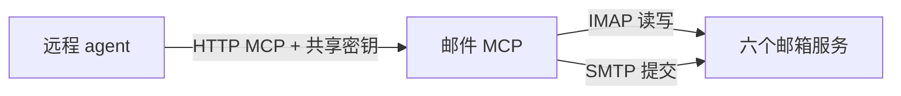

# 邮件 MCP 架构

## Overview

一个 Go 进程同时承担 HTTP MCP 入口、共享密钥校验、IMAP 邮箱读写和 SMTP 邮件提交。它不保存邮件副本。

## System shape

配置声明一个或多个监听网卡、共享密钥文件和多个命名邮箱账号。每次邮箱操作都显式指定账号；服务不为调用方保存当前账号。

## Decisions

- `/mcp` 使用无状态 Streamable HTTP，每个请求必须携带 `Authorization: Bearer …`；不提供独立事件流，不接受 JSON-RPC 批处理。共享密钥授予该实例全部账号的读、写和发信权限；没有账号级的权限隔离或旧密钥只读模式（全量重部署下的权限设计推断，待用户确认）。服务只监听指定网卡在启动时的 IPv4/IPv6 单播地址，不承担防火墙或 HTTPS 终止；需要 HTTPS 时，由部署方在外部代理终止。
- 回环监听保留 SDK 默认的 DNS 重绑定防护。`additional_allowed_hosts` 可为保留原始 Host 的反向代理增加精确 DNS 主机名：仅在原始请求通过跨来源和 Bearer 认证检查后，才为匹配请求的 SDK 副本使用回环 Host。不信任转发 Host 头，不改变非回环连接的行为。
- 搜索的发件人、主题和 IMAP 到达日期条件由上游处理，不下载正文来匹配。结果按 UID 倒序分页，读取邮件和附件时要求匹配同一文件夹的 UID 有效期（`UIDVALIDITY`），避免 UID 重用后读错邮件。
- IMAP 使用校验证书的 TLS。读取使用 `EXAMINE` 和 `BODY.PEEK`；附件按 `BODYSTRUCTURE` 的部件编号按需取回，不将文件落盘。附件在 MCP 边界以 Base64 传输，并限制传输和解码后的大小。
- 写入用同一源文件夹的 UID 与 UIDVALIDITY 定位单封邮件。移动要求原生 `UID MOVE`；不退化为会隐式清除其他已删除邮件的操作。归档和删除使用明确配置或唯一的特殊用途文件夹，缺失或冲突时拒绝。删除仅移入废纸篓。
- 外发使用验证证书的隐式 TLS 或强制 STARTTLS 后的认证 SMTP，发件人来自账号配置。密送仅写入 SMTP 信封；回复使用原信回复地址和线程头，转发保留完整 `.eml`。成功表示 SMTP 确认接收，不保证最终送达或已发送文件夹副本；提交结果未知时不重试。
- 凭据来自服务器本地文件，不通过 MCP 工具创建、修改或返回。Outlook 使用独立 CLI 发起 Microsoft 设备授权，获取 IMAP 和 SMTP 权限；两种协议共享按账号串行刷新并持久化轮换的令牌。其余账号由各自的应用密码文件提供凭据。
- 为小机器限制连接数、并发请求、请求体、上游读取量、FETCH 结构复杂度和邮件正文大小。没有长期连接池、同步任务或本地邮件库。

## Invariants

- 读取邮件、下载附件和获取回复或转发原文均不改变已读状态。
- 一个账号的 IMAP、SMTP 或授权失败不影响其他已配置账号的后续调用。
